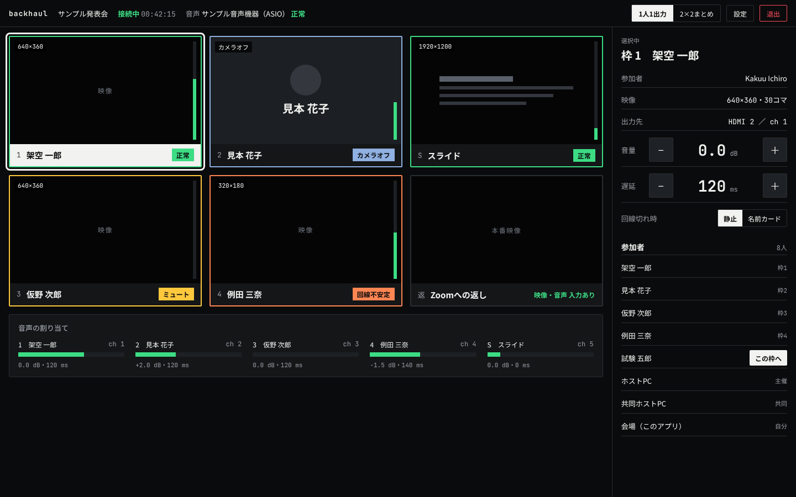

# backhaul

Bring remote Zoom presenters into a live venue: each presenter as a clean full-screen HDMI
output and a separate mono audio channel, with the programme feed and a mix-minus sent back
to Zoom.

> **Status: early development.** The Zoom-independent core logic and the operator screen
> (showing made-up demo data) exist so far. Nothing here can join a meeting yet.

Windows only. Built on the official Zoom Meeting SDK for Windows (not included in this
repository). backhaul is an independent project and is not affiliated with, endorsed by, or
sponsored by Zoom.



## What it will do

- Join a meeting hosted on your own Zoom account and assign participants to slots
- Output each slot full-screen with no on-screen controls (one per display, or a 2x2 grid)
- Send each presenter to its own audio channel on any ASIO / WASAPI device, through an
  assignment table with per-slot level and delay
- Show a name card when a camera is off, and freeze or show the card when a line drops
- Send the venue's programme video and a mix-minus back to the meeting
- Receive at the best quality Zoom allows (1080p for one presenter, 720p for two, 360p for
  three or four) and always output at the display's resolution

## Repository layout

| Path | Contents |
| --- | --- |
| `src/core/` | Core logic with no Zoom, Qt or Windows dependency (quality policy, slot output decisions, aspect fitting, audio routing, delay, 32 kHz to 48 kHz conversion) |
| `src/app/` | The Qt Quick operator application (state, models, screen) |
| `tests/` | Automated tests for the core and for the application state |
| `docs/` | Design notes (Japanese) and screen designs |
| `third_party/` | Where the Zoom SDK and ASIO SDK go locally; never committed |

## Build and test the core

Requires CMake 3.24+ and a C++20 compiler (Visual Studio 2022, GCC 13+, or Clang).

```
cmake -S . -B build -DCMAKE_BUILD_TYPE=Release
cmake --build build --config Release
ctest --test-dir build -C Release --output-on-failure
```

## Build and run the operator screen

Requires Qt 6.4 or newer (Quick). CI builds it with Qt 6.8.3 on Windows and Qt 6.4 on Linux;
the release target is Qt 6.12 LTS once CI can install it.

```
cmake -S . -B build -DBACKHAUL_BUILD_APP=ON
cmake --build build --config Release
backhaul --demo                         # made-up people, no Zoom
backhaul --demo --screenshot out.png    # save a picture of the screen and quit
backhaul --demo --window-size 1280x720  # open at a given size
```

## Documentation

- [Design summary (Japanese)](docs/design.ja.md)

## License

No license has been chosen yet. Until one is added, all rights are reserved.
