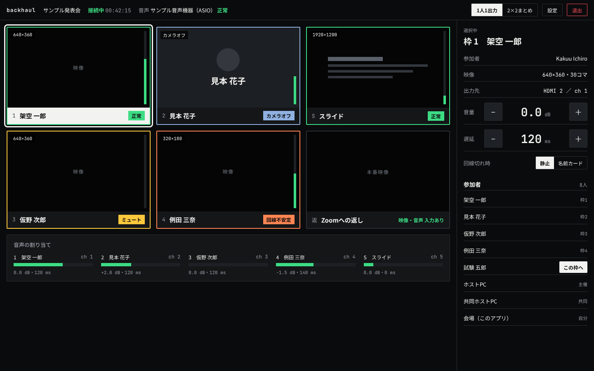

# backhaul 設計の要点

2026年11月27日時点。名前はすべて架空です。

## 何をするアプリか

リアル開催イベントにZoom演者が出演するとき、演者の映像と声を会場機材へ取り込み、会場からの返しをZoomへ送る。外への配信（YouTubeや別のZoom）は既存のエンコーダーと普通のZoomアプリが担当し、このアプリでは作らない。

## 決まっていること

- Windows 11（64ビット）専用。C++20 ＋ Qt 6 ＋ 公式Zoom Meeting SDK for Windows
- 会議は制作側のZoomアカウントで主催する。ホストPC・共同ホストPCは別に用意し、このアプリは参加者として入り、共同ホストにしてもらって取り込みを始める
- ふだんの使い方は「演者1人をピン留め＋スライド」。枠は演者4人＋スライド1枚が初期値で、設定で増やせる
- スライドはスライドだけの単面で出す。共有が16:9でないときは「16:9に切り取る（初期値）」か「全体を出して黒帯」を選べる
- 1080pでも720pでも動く。常にその人数で許される一番高い画質を要求し、届いた解像度のまま受け取り、出力はディスプレイの解像度に合わせて拡大する。上限は「自動／720pまで」から選べる
- まず自社の現場で使い、のちに販売もできる作りにする（Zoomの鍵類を利用者ごとに登録、ASIOなしでも動く）
- 操作画面は「モニター壁」型（下の画像）

## Zoom側の決まり（公式情報で確認）

| 項目 | 内容 |
| --- | --- |
| 同時受信の上限 | 1つの接続で、1080pは1本、720pは2本、360pは4本まで。1080pと720pは混在不可（[Zoom公式ブログ](https://developers.zoom.us/blog/concurrent-video-streaming-limits-desktop-sdks/)） |
| 取り出しの条件 | 主催者か共同ホスト、または主催者からローカル録画の許可が必要。開始時に全員へ同意の表示が出る（[公式資料](https://developers.zoom.us/docs/meeting-sdk/windows/custom-ui/advanced-features/raw-data/)） |
| 形式 | 映像はYUV420、音声はPCMで参加者ごとに別々に受け取れる（同上） |
| 認証 | 自アカウント外の会議はZAKかOBFが必須（[公式資料](https://developers.zoom.us/docs/meeting-sdk/auth/)）。初期バージョンは自アカウントの会議だけを対象にする |

受け取る音声は32kHz・モノラル・16ビットで届く見込み（公式資料に明記なし。開発者フォーラムの報告による）。その場合は48kHzへ変換して出す。

## 枠の状態と、出力に出すもの

| 枠の状態 | HDMIに出すもの | 音声 |
| --- | --- | --- |
| 未割り当て | 黒 | 無音 |
| 正常 | 映像 | 出す |
| カメラオフ | 名前カード | 出す |
| ミュート | 映像 | 無音 |
| 回線不安定 | 映像のまま（操作画面だけ色が変わる） | 出す |
| 切断 | 設定に従い「最後の映像で静止」か「名前カード」 | 無音 |

細かい決め（`src/core/slot_output.cpp` とテストに反映済み）:

- カメラオフとミュートが同時のときは、名前カードで無音
- 切断で「静止」を選んでいても、一度も映像を受け取っていなければ名前カードを出す
- スライドの枠は、誰も共有していなければ黒（警告扱いにしない）。スライドに名前カードはない

## 部品

| 部品 | 役割 | 状況 |
| --- | --- | --- |
| core/quality_policy | 人数と上限設定から、要求する画質を決める | 実装・テスト済み |
| core/slot_output | 枠の状態から、出すものと画面の表示を決める | 実装・テスト済み |
| core/aspect_fit | 縦横比が違うときの切り取り・黒帯の位置を計算する | 実装・テスト済み |
| core/route_matrix | 音声の割り当て表（まとめ・個別音量） | 実装・テスト済み |
| core/delay_line | 枠ごとの音声遅延 | 実装・テスト済み |
| core/resampler | 32kHzから48kHzへの変換 | 実装・テスト済み |
| zoom/ | SDKの初期化、参加、映像・音声の受け取り、返し | 未着手（Zoom SDKの入手後） |
| video/ | 全画面出力、名前カード | 未着手 |
| audio/ | WASAPI・ASIOへの出力と入力 | 未着手 |
| ui/ | 操作画面、設定画面（Qt Quick） | 未着手 |

## 実機で確かめること（まだ未確認）

1. 1人のときに1080p（使えない会議では720p）が届くか。届くコマ数
2. スライド共有が同時受信の上限に数えられるか。共有の最大解像度
3. 720pと360pを混ぜて受けられるか
4. 音声の実際の形式と、映像とのズレの量
5. 返し映像を720p以上で送れるか
6. SDKがPCのスピーカーへ会議音声を出さないようにできるか

## 画面デザイン

